<!-- SPDX-FileCopyrightText: 2025 Contributors to the Media eXchange Layer project. -->
<!-- SPDX-FileCopyrightText: 2026 Contributors to the Media eXchange Layer project. -->
<!-- SPDX-License-Identifier: CC-BY-4.0 -->

# MXL Requirement-Feature Workflow

The Requirements Council (RC) reviews requirements. The Technical Steering Committee (TSC)
manages features, bug fixes and small improvements. The review steps use the
[Definition of Done](DoD.md).

```mermaid
flowchart LR
    forward["Can forward Requirement to other entity<br/>(e.g. JT-DMF, EBU DMF, etc.)"]

    subgraph RC["RC"]
        rc_proposal(["Requirement proposal"])
        rc_initial["Initial Requirement"]
        rc_scope{"Scope review"}
        rc_refine["Requirement refinement"]
        rc_prio["Prioritization of Requirement"]
        rc_review{"Review Feature<br/>against Requirement"}
        rc_closed(["Requirement closed"])
        rc_dod["REQ Definition of Done"]
    end

    subgraph TSC["TSC"]
        subgraph TSC_FEATURE["Feature"]
            f_create["Create Feature(s) and link<br/>to the related Requirement"]
            f_features["Feature(s)"]
            f_triage["Triage:<br/>Feature(s) on roadmap"]
            f_tasks["Dev task(s)<br/>(Feature sub tasks, when needed)"]
            f_assign["Assigning dev task(s) to dev(s)"]
            f_pr["Create PR(s)"]
            f_review{"Review PR(s)"}
        end

        subgraph TSC_BUG["Bug or small improvement"]
            b_start["Bug, small improvement"]
            b_issue["Issue"]
            b_triage["Triage:<br/>Issue on roadmap"]
            b_tasks["Dev task(s)<br/>(Issue sub tasks, when needed)"]
            b_assign["Assigning dev task(s) to dev(s)"]
            b_pr["Create PR(s)"]
            b_review{"Review PR(s)"}
        end

        tsc_dod["TSC Definition of Done"]
        merged(["PR merged in main branch"])
        f_closed["Feature(s) closed"]
        b_closed["Issues closed"]
    end

    %% RC requirement flow
    rc_proposal --> rc_initial --> rc_scope
    rc_scope -- "Out of scope" --> forward
    rc_scope -- "In scope" --> rc_refine
    rc_refine --> rc_prio
    rc_prio --> f_create
    f_create -. "Question(s) for clarification" .-> rc_refine

    %% TSC feature flow
    f_create --> f_features --> f_triage --> f_tasks --> f_assign --> f_pr --> f_review
    f_review -- "Request changes" --> f_pr
    f_review -- "Approved" --> rc_review
    rc_review -- "Request changes" --> f_pr
    rc_review -- "Need new requirement" --> rc_initial
    rc_review -- "Yes" --> rc_closed
    rc_closed --> merged

    %% TSC bug and small improvement flow
    b_start --> b_issue --> b_triage --> b_tasks --> b_assign --> b_pr --> b_review
    b_review -- "Request changes" --> b_pr
    b_review -- "Approved" --> merged

    %% Closing
    merged --> f_closed
    merged --> b_closed

    %% Definitions of Done that apply at each review
    rc_dod -.- rc_review
    tsc_dod -.- f_review
    tsc_dod -.- b_review

    classDef rc fill:#6aaefc,stroke:#1f3a5f,color:#000
    classDef tsc fill:#8f8ffc,stroke:#2a2a6f,color:#000
    classDef external fill:#fb9a3c,stroke:#7a4000,color:#000
    classDef note fill:#ffffff,stroke:#999999,color:#000,stroke-dasharray:4 3
    class rc_proposal,rc_initial,rc_scope,rc_refine,rc_prio,rc_review,rc_closed rc
    class f_create,f_features,f_triage,f_tasks,f_assign,f_pr,f_review tsc
    class b_start,b_issue,b_triage,b_tasks,b_assign,b_pr,b_review tsc
    class merged,f_closed,b_closed tsc
    class forward external
    class rc_dod,tsc_dod note
```

